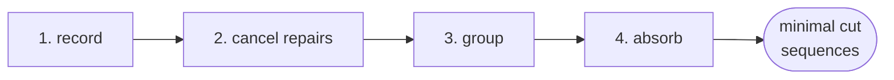

# Sequence analysis: feared events & minimal cut sequences

Safety studies do not only ask *how often* an undesired event occurs:
they ask **which chains of failures lead to it**. RAICHU answers both
natively: declare a **feared event** as a *target*, run a Monte-Carlo
campaign where every trajectory records its causal event sequence and
stops at the first occurrence, then reduce the corpus to **minimal cut
sequences**: the irreducible, ordered failure combinations that reach
the event, weighted by how many trajectories they explain.

## Declaring a feared event

The simplest way is an `ObjEvent` plugin object flagged `"target": true`:
its `occ` state becomes the trajectory-stopping target and the label of
every recorded sequence.

```json
{
  "type": "ObjEvent", "name": "system_down", "target": true,
  "cond": [[
    {"obj": "A", "attr": "flow", "ope": "==", "value": false},
    {"obj": "B", "attr": "flow", "ope": "==", "value": false}
  ]]
}
```

At the native level this is a model-wide `targets` entry: any automaton
state can be one (see the [model schema](../reference/model-schema.md)):

```json
"targets": [{"name": "system_down", "component": "system_down",
             "automaton": "ev", "state": "occ"}]
```

When a target state activates, the engine finishes the current instant
(everything due at the same date still fires), records the **end cause**,
and stops the trajectory: the *first-occurrence* semantics of safety
campaigns.

A study written in muscadet says the same thing by naming the event on the
**run** rather than on the model: `system.simulate(params, engine="raichu",
targets=["EVT_LOSS"])`, and `pyraichu.muscadet.engine.build_model(spec,
targets=[...])` for the model this page's `analyse_sequences` takes. One
system is run twice, free-cycling for its availability figures and
first-occurrence for its sequences, which is why a target is a parameter of
the run there. See the [muscadet engine guide](muscadet-engine.md).

## From trajectories to minimal cut sequences

`pyraichu.analyse_sequences` runs the campaign and the whole reduction
pipeline:

```python
import pyraichu

model = pyraichu.load_model({
    "name": "redundant_pair",
    "plugins": {"muscadet": {"objects": [
        # One failure mode with common-cause orders over two targets:
        # order 1 = independent failures, order 2 = both at once.
        {"type": "ObjFM", "name": "fm", "targets": ["A", "B"],
         "failure": [{"law": "exp", "rate": 0.1}, {"law": "exp", "rate": 0.03}],
         "repair":  [{"law": "exp", "rate": 0.5}, {"law": "exp", "rate": 0.5}],
         "failure_effects": {"flow": False}},
        {"type": "ObjEvent", "name": "system_down", "target": True,
         "cond": [[{"obj": "A", "attr": "flow", "ope": "==", "value": False},
                   {"obj": "B", "attr": "flow", "ope": "==", "value": False}]]},
    ]}},
    "components": [
        {"name": n,
         "attributes": [{"name": "flow", "kind": "bool",
                         "init": {"kind": "bool", "value": True}}]}
        for n in ("A", "B")
    ],
    "indicators": [{"name": "system_down_occ", "target": "state",
                    "component": "system_down", "automaton": "ev",
                    "state": "occ"}],
})

cuts = pyraichu.analyse_sequences(model, nb_runs=2000, t_max=100.0, seed=42)
for cut in cuts:
    if cut["end_cause"] == "system_down":
        chain = " → ".join(f"{e['obj']}.{e['attr']}" for e in cut["events"])
        print(f"{cut['weight']:5.0f}  {chain}")
```

```text
 1075  fm.occ__cc_1_2 → system_down.occ
  478  fm.occ__cc_2 → fm.occ__cc_1 → system_down.occ
  441  fm.occ__cc_1 → fm.occ__cc_2 → system_down.occ
```

Three minimal cut sequences: the **common-cause** direct path dominates,
and the two **order-dependent** sequential paths (A-then-B vs B-then-A)
are reported separately: sequences are ordered, unlike classic cut
*sets*. Weights are trajectory counts: divide by `nb_runs` for
probabilities. The result is seed-reproducible bit-for-bit.

The pipeline behind the call:



1. **Record**: each trajectory logs its *monitored* transitions (the
   plugin marks failure/repair and event transitions automatically) and
   stops at the first target.
2. **Cancel transient cycles**: a failure that was repaired *before*
   the feared event did not cause it: paired failure/repair events of
   the same mode are removed (per component, so distinct modes never
   cancel each other), unless the engine decided that the mode's effect
   outlives its repair, or the cancellation would leave the trajectory
   without a cause (see below).
3. **Group**: trajectories left with the same ordered event signature
   merge; weights add up and dates are averaged.
4. **Minimal absorption**: a sequence that contains a shorter reaching
   sequence is absorbed into it; only irreducible cuts remain.

Steps 2 and 3 run on each trajectory as the campaign produces it, and the
trajectory is then dropped: a campaign holds one chunk of trajectories in
flight plus one entry per distinct cleaned path, so its memory does not grow
with `nb_runs`. Cancelling before grouping is what makes that hold on a
repairable system, where nearly every raw trajectory is distinct (its
transient cycles differ) while the paths left once they are cancelled are
few. Up to 0.81.0 every trajectory was held until the end of the campaign,
which ran out of memory at 1e7 trajectories on a 39-component repairable
model. A trajectory that keeps its cycles (see below) is held with them, so a
campaign in which many trajectories keep their cycles, each with a different
history, grows with those histories.

Two results can differ from 0.81.0, which also grouped once before
cancelling. Averaged dates may differ in their last bits. And when a longer
sequence contains two minimal ones of the same length and weight, 0.81.0
absorbed it into whichever its grouping order put first; it now goes to the
one with the smaller event signature, so the minimal level depends only on
the cleaned paths and their weights, never on the order they were reduced
in.

**When a repaired failure still counts.** Step 2 assumes that a repair
undoes the failure's effect. A quantity that remembers can keep it: a
storage that drained while a producer was down stays low after the repair,
and the feared event can come hours later with every failure repaired.
Cancelled, such a trajectory would have no cause left: nothing at all, or
only the feared event's own observation. Either sequence is contained in
every other one, so step 4 would absorb the whole campaign into it, and the
analysis would answer that no failure is needed.

The engine therefore decides, per cycle group and per feared event, before
any run, whether step 2 may cancel the group. A group is **kept**, its whole
history staying in the sequences, when its effect reaches the feared event
through a quantity that remembers it:

- an ODE, which integrates what it reads;
- an FMU output, whose state the engine cannot see;
- an attribute a transition effect writes, unless the group's own repair
  restores its initial value;
- a timer that survives an interruption (`on_interruption: resume` or
  `continue`);
- an automaton on the way, such as a controller switching on a band or a
  protection that trips and stays tripped. Exempt are another monitored
  cycle group, whose persistence the sequence records as its own events;
  an automaton read only by recorded automata that copy it at once (two
  states, left instantly and without effect on complementary guards), so
  that its state is at every instant what their recorded events show: the
  own automaton of a muscadet `external` failure mode and the mirrors it
  drives on its targets; and an automaton entered and left at once on a
  condition and its negation, whose state follows its inputs. A recorded
  reader that waits (a rate, a delay) does not exempt what it reads: it
  fires after the repair, and the sequence would not show that its input
  held the effect meanwhile.

`pyraichu.cycle_groups(model)` shows the decisions with the path that
justifies each one, and a campaign reports the ones it applied in
`campaign.reduction["cycle_groups"]`. On the
[hydrogen installation](../examples/h2-installation.md) the compressors are
cancellable and the production chain is kept, through the storage.

What the analysis cannot see is a latch or a counter kept by a sensitive
function. A transition declares `cycle_cancellation: never` for that: its
group is then never cancelled. `always` forces the cancellation instead,
when the analyst knows the effect is gone; `auto`, the default, lets the
engine decide. Every transition of a group declares the same value, and a
value other than `auto` needs the `cycle_cancellation` feature.

A last check backs the decision up. A trajectory that reached a feared
event and that cancellation would still leave empty, or with only repairs
and observations while a declared failure was cancelled, keeps its cycles:
a feared event cannot happen without a cause. The declared roles come from
each transition's `kind` (the muscadet plugin declares them); an event
whose transition declares none is counted as a possible cause.
`analyse_sequences` emits a `pyraichu.ReductionWarning` when that happens,
since it means a memory the decision did not see or a feared event with an
unmonitored cause, and `run_sequences` reports those trajectories in
`campaign.reduction`: their number, their weight, and the replica indices of
the first hundred.

Two limits remain. A kept group keeps its whole history in the
trajectories that reach the feared event, so the cleaned level holds more
distinct paths; a trajectory that reached no feared event cancels every
group, having no cause to keep. Measured on 2026-10-12 (seed 1, one
thread per core, `cycle_group` on every component):

| Model, replicas | Every group cancelled | With the decision |
|---|---|---|
| heated room (90 days), 1 000 | 7 paths, 90 MB | 112 paths, 92 MB |
| heated room (90 days), 10 000 | 7 paths, 105 MB | 553 paths, 123 MB |
| heated room (90 days), 100 000 | 7 paths, 109 MB | 2 847 paths, 222 MB |
| hydrogen installation (1 year), 1 000 | 35 paths, 45 MB | 181 paths, 46 MB |
| hydrogen installation (1 year), 10 000 | 115 paths, 61 MB | 1 042 paths, 79 MB |
| hydrogen installation (1 year), 100 000 | 622 paths, 79 MB | 4 968 paths, 183 MB |

The paths grow about five times for ten times the replicas, and the run
time does not move (the reduction is not where a campaign spends it: 422 s
against 430 s on the heated room at 100 000 replicas, 4 033 s against
4 045 s on the hydrogen installation). The minimal level holds as many
sequences in both columns (3 on the heated room, 6 on the hydrogen
installation); on the hydrogen installation, with every group cancelled,
736 of the 100 000 trajectories are contradicted and reported, none with
the decision. A
trajectory can also be absorbed into an earlier failure of a kept group
whose effect had already died out. And importance
measures read the failures active at the feared event, independently of
`cycle_group`: a repaired failure with a lasting effect is still invisible
to them. Up to 0.84.0 the collapse happened silently; 0.85.0 added the last
check, 0.86.0 the decision.

## Keeping the raw corpus

`analyse_sequences` returns the minimal sequences and discards what they were
reduced from. `run_sequences` runs the same campaign (the same seed gives the
same trajectories) and keeps it: the two reduced levels come back, and every
trajectory's raw sequence is written to `raw_path` in the
[`raichu.sequences` format](../reference/sequence-format.md), straight from the
engine.

```python
campaign = pyraichu.run_sequences(model, nb_runs=2000, t_max=100.0, seed=42,
                                  raw_path="campaign.jsonl")
campaign.minimal   # what analyse_sequences returns
campaign.cleaned   # every distinct path, transient cycles removed

again = pyraichu.analyse_raw_sequences("campaign.jsonl")
assert again.minimal == campaign.minimal
```

The raw corpus holds one line per trajectory, dates included, so it is the
level to audit a campaign on, to filter, or to hand to another tool. It is
written line by line as the campaign runs, and `analyse_raw_sequences` reads
it line by line: neither holds the trajectories, so the file is the only
thing that grows with `nb_runs` (about 1.6 kB per trajectory on a two-component
repairable model over 200 time units).

### What an event of a reduced sequence says

Every event of `campaign.cleaned` and `campaign.minimal` (and of what
`analyse_sequences` returns) is `{obj, automaton, attr, time, kind}`:

| Field | Meaning |
|---|---|
| `obj` | the component |
| `automaton` | the automaton of that component whose state was entered, `null` when the source names none |
| `attr` | the monitored state entered |
| `time` | the firing date, averaged over the trajectories merged into the path |
| `kind` | the role the model declares for the transition: `"failure"`, `"repair"`, `"observation"`, or `null` |

`kind` is what the raw corpus records for the event, so a reader tells a
failure from a repair by what the model declares rather than by the name of
a state (`occ` and `rep` are muscadet's names; a hand-written model calls
them what it likes). It is `null` when the transition declares no `kind`,
when it entered a branch other than its first declared target, and on a
cleaned event whose merged trajectories do not all declare the same kind:
the field states what is true of every trajectory behind the event, and
nothing it would have to choose. A minimal sequence keeps its own events;
the longer ones it absorbs add their weight and nothing else.

```python
for cut in campaign.minimal:
    if cut["end_cause"] == "system_down":
        failures = [f"{e['obj']}.{e['automaton']}" for e in cut["events"]
                    if e["kind"] == "failure"]
        print(f"{cut['weight']:5.0f}  {' + '.join(failures)}")
```

```text
 1075  fm.fm__cc_1_2
  478  fm.fm__cc_2 + fm.fm__cc_1
  441  fm.fm__cc_1 + fm.fm__cc_2
```

The reduction identifies an event by its component, its state **and** its
automaton: two automata of one component that reach a state of the same
name (an independent and a common-cause mode of one pump, both reaching
`down`) are two causes, and give two paths. Before 0.99.0 the automaton was not
part of that identity, so such events merged into one path; on a model whose
automata name their states apart, as muscadet's do, nothing changes.

A corpus written before 0.83.0 names no automaton, and one written before
0.85.0 declares no kind: re-reduced with `analyse_raw_sequences`, its events
read `null` for what it does not carry, and its paths are the ones it always
gave.

### Observing a value, and reducing under a condition

A campaign can also read chosen attributes at chosen instants on every
trajectory, and reduce only the trajectories whose reading satisfies a
condition. An `Observation(name, component, attribute, time)` records the
value; a `SequenceCondition(observation, op, value)` keeps a trajectory when
that value compares to `value` as `op` says (`==`, `!=`, `<`, `<=`, `>`,
`>=`). A boolean reads `0` or `1`:

```python
# The paths to the feared event among trajectories where A still delivered at t = 50.
conditioned = pyraichu.run_sequences(
    model, nb_runs=2000, t_max=100.0, seed=42, raw_path="conditioned.jsonl",
    observations=[pyraichu.Observation("A_at_50", "A", "flow", 50.0)],
    condition=pyraichu.SequenceCondition("A_at_50", "==", 1.0),
)
report = conditioned.condition
assert report["kept_trajectories"] <= report["total_trajectories"] == 2000

# The corpus keeps every trajectory, so it answers another condition later.
other = pyraichu.analyse_raw_sequences(
    "conditioned.jsonl", condition=pyraichu.SequenceCondition("A_at_50", "==", 0.0))
assert (other.condition["kept_trajectories"] + report["kept_trajectories"]
        == report["total_trajectories"])
```

Observing changes no trajectory: the same seed gives the same corpus,
observations added. The exact reading rules (a trajectory stopped earlier, an
instant past the horizon) are in the
[corpus format reference](../reference/sequence-format.md#observations).

## First-occurrence indicators

The Monte-Carlo estimator has the matching measures. By default
`monte_carlo` lets trajectories run and cycle freely: an
*availability* view. With `stop_at_targets=True` it applies the same
early-stop as the sequence analysis and **latches** the state: once the
feared event occurs, it stays occurred through every later sampling
instant: a *reliability / first-occurrence* view.

```python
est = pyraichu.monte_carlo(model, nb_runs=2000, t_max=100.0,
                           samples=[50.0, 100.0], seed=42,
                           stop_at_targets=True)
ind = est.indicators["system_down_occ"]
ind.nb_occurrences_mean   # P(occurred by t): at most one per trajectory
ind.sojourn_mean          # mean time elapsed since the first occurrence
```

`nb_occurrences_mean` / `nb_occurrences_std` (the number of state
entries up to each instant) are also estimated in the free-cycling mode,
where an event can occur repeatedly.

!!! note "Which mode to compare with what"
    When cross-checking against another tool, match the semantics:
    campaigns recorded **with** targets measure first-occurrence
    quantities (latched sojourn ≈ horizon − first hit), campaigns
    **without** measure cumulated exposure. The two differ by orders of
    magnitude on repairable systems.

## From cut sequences to importance measures

The minimal cut sequences are also the support of the **importance
measures**: which component contributes most to the feared event, and
where investment pays. Dropped to sets they are the minimal cut sets,
hence the structure function of the system, and the same campaign replays
the state of every failure mode at any instant. See [importance
measures](importance-measures.md).

```python
analysis = pyraichu.importance(model, nb_runs=2000, t_max=100.0,
                               instants=[50.0, 100.0], seed=42)
for name, component in analysis.components.items():
    print(name, component.birnbaum[-1], component.fussell_vesely[-1])
```

## Native model, without plugins

Sequence recording works on hand-written models too: set
`"monitored": true` on the transitions you want in the sequences, group
failure/repair pairs with a shared `"cycle_group"`, and declare
`targets`. The plugin layer simply does this annotation for you.
